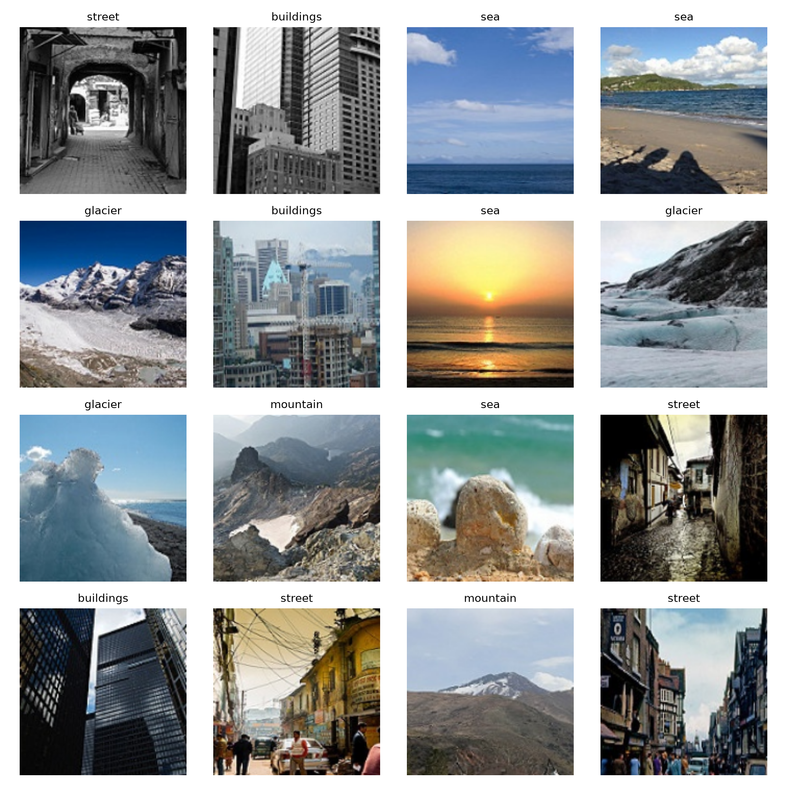
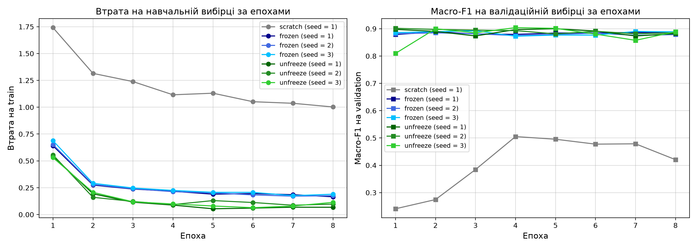
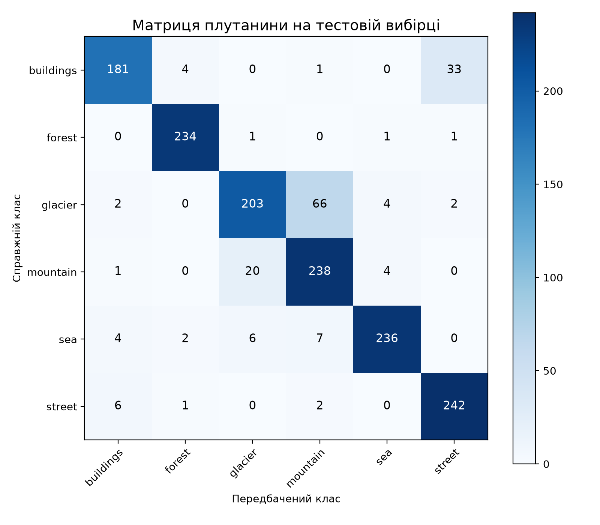
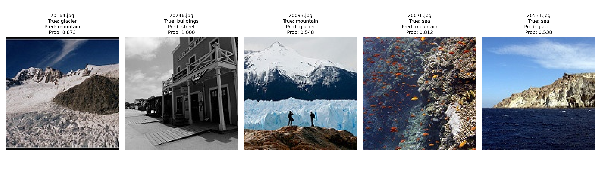

# Лабораторна робота №3. Обчислювальний експеримент і трансферне навчання

## Посилання на набір даних та команди відтворення

* **Набір даних:** [Intel Image Classification на Kaggle](https://www.kaggle.com/datasets/puneet6060/intel-image-classification)
* **Команда аналізу наявних результатів:**
  ```bash
  uv run python lab3/analyze.py --data-dir lab3/data --out-dir lab3/runs
  ```
* **Команда повного навчання з нуля:**
  ```bash
  uv run python lab3/train.py --data-dir lab3/data --out-dir lab3/runs_new
  ```
  > [!NOTE]
  > Для захисту від випадкового перезапису попередніх результатів скрипт `train.py` перевіряє наявність каталогу `--out-dir` і викидає виняток `FileExistsError`, якщо тека вже існує. Тому для нового прогону слід вказувати нову теку (наприклад, `lab3/runs_new`). Для аналізу результатів цього звіту використовуйте вже збережену в репозиторії теку `lab3/runs`.

---

## 1. Перевірки до навчання

### Таблиця контролю детермінованого поділу вибірки
Вихідні дані розбито за детермінованим протоколом: для навчальної вибірки відібрано рівно по 200 зображень на кожен із 6 класів із теки `seg_train` за допомогою генератора `np.random.default_rng(0)`, а валідаційну та тестову вибірки сформовано поділом навпіл за алфавітним списком файлів з теки `seg_test` за допомогою окремого генератора `np.random.default_rng(0)`.

Усі 18 клітинок контрольної таблиці повністю збігаються з вимогами завдання:

| Клас | train: кількість / сума | validation: кількість / сума | test: кількість / сума |
| :--- | :---: | :---: | :---: |
| `buildings` | 200 / 1 996 761 | 218 / 4 837 323 | 219 / 4 837 559 |
| `forest` | 200 / 2 032 625 | 237 / 5 276 962 | 237 / 5 291 326 |
| `glacier` | 200 / 2 183 923 | 276 / 6 135 652 | 277 / 6 157 250 |
| `mountain` | 200 / 1 950 345 | 262 / 5 789 535 | 263 / 5 849 765 |
| `sea` | 200 / 1 987 613 | 255 / 5 655 068 | 255 / 5 668 011 |
| `street` | 200 / 1 841 817 | 250 / 5 541 845 | 251 / 5 547 533 |
| **Разом** | **1200 / 11 993 084** | **1498 / 33 236 385** | **1502 / 33 351 444** |

Перевірка множин показала, що жоден файл не входить у дві різні частини вибірки: перетин між усіма парами підвибірок дорівнює 0, а загальна кількість унікальних файлів становить рівно 4 200.

Збережений розподіл зафіксовано у файлі `split.csv` із контрольним хешем:
$$\text{SHA-256}(\texttt{split.csv}) = \texttt{b29c53c7e41b0c4bb36e54d8ca3a9bcbac11eca96abeab8ba4fbcf5937a160b8}$$

### Пакет після перетворень
Для перевірки коректності вхідного конвеєра даних перші 16 зображень навчального пакета збережено після застосування випадкового кадрування `RandomResizedCrop(160, scale=(0.7, 1.0))`, дзеркального відображення `RandomHorizontalFlip` та оберненого перетворення нормалізації:

<p align="center">
  
</p>

### Початкова втрата $L_0$
Для 6 класів теоретична втрата моделі за умови рівноймовірних передбачень дорівнює:
$$L_{\text{theory}} = \ln 6 \approx 1.79176$$

Практично виміряна початкова втрата на першому пакеті до оновлення ваг становить:
* **Режим `scratch` для зерна 1:** $L_0 = 2.04788$
* **Режим `frozen` для зерна 1:** $L_0 = 1.92439$

**Пояснення відхилення:**
1. **Зміст теоретичного значення:** Втрата $L_{\text{theory}} = \ln 6 \approx 1.79176$ відповідає випадку ідеально невпевненої моделі, яка видає однакову ймовірність $1/6$ для кожного із шести класів, тобто її вихідні логіти є повністю рівними між собою.
2. **Причина відхилення на першому кроці:** У реальній моделі ваги ініціалізуються випадково, тому для кожного зображення вихідні логіти мають випадковий розкид, а передбачені ймовірності класів не є однаковими. Оскільки початкова втрата $L_0$ вимірюється лише на одному невеликому мініпакеті з 32 зображень, випадковий вибірковий шум закономірно викликає відхилення середньої втрати від теоретичного числа.
3. **Різниця між режимами:**
   * У режимі `frozen` зі значенням $L_0 = 1.92439$ кістяк моделі вже навчений на ImageNet, а його активації стабілізовані фіксованими шарами пакетної нормалізації, тому випадковою є лише невелика класифікаційна голова `fc`, що дає помірний розкид виходів.
   * У режимі `scratch` зі значенням $L_0 = 2.04788$ випадково ініціалізовані всі 18 блоків мережі, тому неузгоджені між собою шари створюють значно більшу хаотичність активацій на першому ж проході, спричиняючи помітніше відхилення від $\ln 6$.

---

## 2. Перевірка режимів навчання

### Кількість параметрів та склад груп оптимізатора
Згідно з архітектурою ResNet-18, загальна кількість параметрів мережі складає 11 179 590:

| Режим | Ваги | Параметрів, що навчаються | Склад груп AdamW | Швидкість навчання ($\eta$) | Модулі у `eval()` |
| :--- | :--- | :---: | :--- | :---: | :--- |
| `scratch` | Випадкові | 11 179 590 | Всі параметри (11 179 590) | $3 \cdot 10^{-3}$ | — |
| `frozen` | ImageNet | 3 078 | Тільки `fc` (3 078) | $3 \cdot 10^{-3}$ | `conv1`, `bn1`, `layer1–4` |
| `unfreeze` | ImageNet | 8 396 806 | Група 0: `fc` (3 078)<br>Група 1: `layer4` (8 393 728) | $3 \cdot 10^{-3}$<br>$3 \cdot 10^{-4}$ | `conv1`, `bn1`, `layer1–3` |

**Обґрунтування різниці швидкостей навчання та потреби меншої швидкості для кістяка:**
У режимі `unfreeze` для голови класифікатора `fc` встановлено $\eta = 3 \cdot 10^{-3}$, а для останнього згорткового блоку `layer4` — на порядок меншу швидкість $\eta = 3 \cdot 10^{-4}$. Це зумовлено такими факторами:
1. **Захист від катастрофічного забування:** Згорткові ваги `layer4` уже навчені на 1.28 млн зображень ImageNet і перебувають в околі якісного мінімуму, кодуючи складні візуальні ознаки. Голова `fc` ініціалізується з нуля і на перших кроках генерує хаотичні передбачення з великими градієнтами. Якби ці початкові градієнти пройшли у `layer4` зі швидкістю $\eta = 3 \cdot 10^{-3}$, вони зруйнували б стабільні репрезентації ImageNet.
2. **Різні ролі в оптимізації:** Новий лінійний шар `fc` потребує швидшого оновлення для підбору роздільних меж під нові 6 класів із $\eta = 3 \cdot 10^{-3}$. Натомість блок `layer4` потребує лише обережного тонкого донавчання та адаптації своїх фільтрів під геометрію і текстури Intel Image Classification зі зниженою швидкістю $\eta = 3 \cdot 10^{-4}$.

### Перевірка змін модулів за 5 кроків оптимізатора
Для режимів `frozen` та `unfreeze` виконано точне порозрядне порівняння параметрів та ковзних статистик пакетної нормалізації `running_mean`, `running_var`, `num_batches_tracked` через `torch.equal`:

| Режим | Модуль | Параметри змінилися | Ковзні статистики BN змінилися | Збігається з очікуваним |
| :--- | :--- | :---: | :---: | :---: |
| `frozen` | `conv1` | ні | немає BN | так |
| `frozen` | `bn1` | ні | ні | так |
| `frozen` | `layer1` | ні | ні | так |
| `frozen` | `layer2` | ні | ні | так |
| `frozen` | `layer3` | ні | ні | так |
| `frozen` | `layer4` | ні | ні | так |
| `frozen` | `fc` | так | немає BN | так |
| `unfreeze` | `conv1` | ні | немає BN | так |
| `unfreeze` | `bn1` | ні | ні | так |
| `unfreeze` | `layer1` | ні | ні | так |
| `unfreeze` | `layer2` | ні | ні | так |
| `unfreeze` | `layer3` | ні | ні | так |
| `unfreeze` | `layer4` | так | так | так |
| `unfreeze` | `fc` | так | немає BN | так |

Результати перевірки повністю підтвердили цілісність заморожування: модулі, зазначені у стовпці `У eval()`, не зазнали змін ані у вагах, ані у статистиках BN.

### Дослід із навмисною помилкою
* **Прогноз перед запуском:** Оскільки для параметрів кістяка виставлено `requires_grad=False`, їхні вагові коефіцієнти залишаться незмінними. Проте виклик `model.train()` переводить усі шари `BatchNorm2d` у режим оновлення ковзних статистик поточним пакетом цільового набору даних. Це призведе до вимивання статистик ImageNet та їх заміщення статистиками малої навчальної вибірки без оновлення ваг згорток. На кривій втрати на навчальній вибірці це помітити не вдасться, адже класифікаційна голова оптимізуватиметься під вихід зміненого кістяка, але узагальнююча здатність на валідації деградує.
* **Фактичний результат після 5 кроків:**
  * Максимальна абсолютна зміна `running_mean` у шарі `layer1.0.bn1`: **$0.09283638$**
  * Максимальна абсолютна зміна `running_var` у шарі `layer1.0.bn1`: **$0.12031436$**
* **Теоретичне обґрунтування:** Атрибут `requires_grad=False` керує виключно обчисленням градієнтів для автодиференціювання в оптимізаторі і жодним чином не блокує зміну статистик BN. Оновлення ковзного середнього і дисперсії в `BatchNorm2d` відбувається під час прямого проходу за формулою експоненційного згладжування, коли прапорець `self.training == True`. Для `layer4` у режимі `unfreeze` оновлення статистик є правильним, оскільки ваги згорток цього шару адаптуються під новий розподіл зображень і зміщують просторові карти активацій, тому ковзні статистики зобов'язані калібруватися під нові активації.

---

## 3. Сім запусків за протоколом

Експеримент проведено за фіксованим обчислювальним бюджетом: рівно 8 епох по 38 кроків оптимізатора на пристрої NVIDIA GeForce RTX 4050 Laptop GPU.

| № | Режим | Зерно | Втрата на train, епоха 8 | Macro-F1 на validation, епоха 8 | Час навчання, с |
| :-: | :--- | :-: | :---: | :---: | :---: |
| 1 | `scratch` | 1 | 1.0022 | 0.4206 | 38.74 |
| 2 | `frozen` | 1 | 0.1655 | 0.8842 | 34.42 |
| 3 | `frozen` | 2 | 0.1757 | 0.8785 | 35.14 |
| 4 | `frozen` | 3 | 0.1896 | 0.8886 | 33.86 |
| 5 | `unfreeze` | 1 | 0.0679 | 0.8821 | 33.25 |
| 6 | `unfreeze` | 2 | 0.0974 | 0.8852 | 33.09 |
| 7 | `unfreeze` | 3 | 0.1139 | 0.8890 | 33.05 |

### Криві навчання для всіх семи запусків
Графіки зміни функції втрати на навчальній вибірці та метрики Macro-F1 на валідаційній вибірці збережено на спільних осях у файлі `runs/figures/training_curves.png`:

<p align="center">
  
</p>

---

## 4. Розклад ефектів

Розрахунок середнього $\bar{F}_r$ та розмаху $R_r = \max_s F_{r,s} - \min_s F_{r,s}$ за трьома зернами генератора:

$$\bar{F}_{\text{frozen}} = \frac{0.8842 + 0.8785 + 0.8886}{3} = 0.8838, \quad R_{\text{frozen}} = 0.8886 - 0.8785 = 0.0101$$

$$\bar{F}_{\text{unfreeze}} = \frac{0.8821 + 0.8852 + 0.8890}{3} = 0.8855, \quad R_{\text{unfreeze}} = 0.8890 - 0.8821 = 0.0069$$

Поріг оцінки випадкового шуму:
$$R = \max(R_{\text{frozen}}, R_{\text{unfreeze}}) = \max(0.0101, 0.0069) = 0.0101$$

Ефект попередньо навчених ознак ($\Delta_{\text{pre}}$) та ефект розморожування кістяка ($\Delta_{\text{unf}}$):
$$\Delta_{\text{pre}} = \bar{F}_{\text{frozen}} - F_{\text{scratch}, 1} = 0.8838 - 0.4206 = +0.4632$$
$$\Delta_{\text{unf}} = \bar{F}_{\text{unfreeze}} - \bar{F}_{\text{frozen}} = 0.8855 - 0.8838 = +0.0017$$
$$\Delta_{\text{total}} = \Delta_{\text{pre}} + \Delta_{\text{unf}} = \bar{F}_{\text{unfreeze}} - F_{\text{scratch}, 1} = 0.4632 + 0.0017 = +0.4649$$

### Підсумкова таблиця величин

| Величина | Значення | Вердикт за консервативним правилом при $\vert\Delta\vert > R$ |
| :--- | :---: | :--- |
| $\bar{F}_{\text{frozen}}, R_{\text{frozen}}$ | 0.8838, 0.0101 | — |
| $\bar{F}_{\text{unfreeze}}, R_{\text{unfreeze}}$ | 0.8855, 0.0069 | — |
| **Поріг шуму $R$** | **0.0101** | Базова межа чутливості |
| $\Delta_{\text{pre}}$ | **+0.4632** | $\vert\Delta_{\text{pre}}\vert > R \implies$ **ефект вартий перевірки, перевищення шуму приблизно у 46 разів** |
| $\Delta_{\text{unf}}$ | **+0.0017** | $\vert\Delta_{\text{unf}}\vert \le R \implies$ **різниця не відрізняється від розкиду, результату немає** |

### Аналітичні відповіді на питання експерименту
1. **Що саме змінює зерно в кожному режимі:**
   * **`frozen`:** зерно змінює лише два стохастичні чинники — випадкову ініціалізацію 3 078 ваг нового вихідного шару `fc` та випадковості конвеєра даних, зокрема черговість мініпакетів при перемішуванні та координати випадкового кадрування й перевороту зображень. Усі 8,4 млн параметрів `layer4` та решта кістяка залишаються повністю замороженими й незмінними.
   * **`unfreeze`:** початкові ваги `layer4` завантажені з ImageNet і однакові для всіх зерен, проте тепер вони оновлюються оптимізатором. Зерно змінює їхнє фінальне положення через два конкретні механізми:
     1) *Різний старт класифікатора:* різна ініціалізація ваг `fc` задає інший напрям зворотного поширення градієнтів, що проходять крізь нього у `layer4` за ланцюговим правилом;
     2) *Стохастичність даних:* інша послідовність мініпакетів і випадкових трансформацій зображень на кожному з 304 кроків формує інший вектор градієнта.
   * **`scratch`:** зерно додатково визначає випадкову початкову ініціалізацію абсолютно всіх 11,2 млн ваг мережі з нуля.
2. **Чому поріг $R$ не характеризує розкид запуску `scratch` і чи змінює це висновок щодо $\Delta_{\text{pre}}$:**
   * **Невідповідність порогу $R$:** Поріг $R = 0.0101$ розраховано виключно за трансферними запусками, де кістяк уже перебуває у стабільному локальному мінімумі ImageNet, а стохастичність обмежена головою `fc` та випадковостями аугментацій. Навчання з нуля `scratch` має принципово іншу і вищу дисперсію через випадкову ініціалізацію абсолютно всіх 11.2 млн ваг мережі та блукання у складному нелінійному ландшафті оптимізації. Оскільки за протоколом запуск `scratch` виконувався лише для одного зерна, його власний міжзерновий розкид експериментально не вимірювався і не може прирівнюватися до $R$.
   * **Аналіз кривої першого запуску:** Графік валідаційної кривої у файлі `runs/figures/training_curves.png` демонструє виражену динамічну нестабільність навчання з нуля: значення Macro-F1 починається з 0.2407 на першій епосі, стрімко зростає до піку 0.5041 на четвертій епосі, а далі деградує та опускається до 0.4206 на восьмій епосі. Внутрішній розмах коливань метрики між епохами лише для одного цього запуску складає $\Delta F_{\text{epochs}} = 0.5041 - 0.4206 \approx 0.0835$, що більш ніж у 8 разів перевищує поріг шуму $R = 0.0101$ трансферних режимів. Це наочно ілюструє, що за фіксованого бюджету у 304 кроки модель `scratch` далека від стаціонарної збіжності, а її втрата на навчальній вибірці 1.0022 свідчить про недонавчання.
   * **Чи змінює це висновок щодо $\Delta_{\text{pre}}$:** **Ні, це не змінює висновок.** Виміряний ефект попереднього навчання є визначальним: $\Delta_{\text{pre}} = \bar{F}_{\text{frozen}} - F_{\text{scratch}, 1} = +0.4632$. Навіть якщо взяти пікове значення `scratch` на четвертій епосі 0.5041, відставання `scratch` від `frozen` зі значенням близько 0.884 все одно становить від 38 до 46 пунктів Macro-F1. Такий величезний розрив у рази перекриває будь-яку теоретичну невизначеність від незвіданого розкиду `scratch`. Отже, висновок залишається непорушним: попередня навченість ознак дає фундаментальну перевагу над навчанням з нуля в умовах малого обчислювального бюджету.
3. **Чи однаковий бюджет за часом навчання:**
   Попри ідентичну кількість із 304 кроків оптимізатора, фактичний час навчання дещо відрізняється: для `scratch` зворотне поширення похибки через усі 18 згорткових блоків потребувало найбільше часу — близько 39 секунд. Режими `frozen` та `unfreeze` виконувалися швидше — у межах 33–35 секунд завдяки відсутності розрахунку градієнтів для ранніх шарів.

---

## 5. Вибір конфігурації та тестова оцінка

### Вибір конфігурації за валідаційною вибіркою
* Середнє за режимами: $\bar{F}_{\text{unfreeze}} = 0.8855 > \bar{F}_{\text{frozen}} = 0.8838 > F_{\text{scratch}} = 0.4206$.
* Найкращий режим: **`unfreeze`**.
* Найкраще зерно в обраному режимі: **зерно 3** з валідаційним $\text{Macro-F1} = 0.8890$.
* *Важливе застереження:* оскільки $|\Delta_{\text{unf}}| = 0.0017 \le R = 0.0101$, формальна перевага режиму `unfreeze` над `frozen` зумовлена винятково стохастичним шумом вибірки.

### Одноразова оцінка на тестовій вибірці
* **Macro-F1 на тестовій вибірці:** **0.8900**
* **Macro-F1 на валідаційній вибірці вибраного запуску:** **0.8890**
* **Частка правильних відповідей на тестовій вибірці ($p$):** **0.8881**
* **Стандартна похибка частки правильних відповідей:**
  $$\text{SE} = \sqrt{\frac{p(1 - p)}{n}} = \sqrt{\frac{0.8881 \cdot (1 - 0.8881)}{1502}} \approx 0.0081$$

**Порівняння оцінок та аналіз зміщення вибору:**
* **Теоретичне оптимістичне зміщення:** Коли підсумкова модель обирається за правилом максимуму серед трьох запусків на валідаційній вибірці, математичне сподівання максимуму оцінок систематично перевищує справжнє сподівання узагальнюючої здатності:
  $$\mathbb{E}[\max_s F_{r,s}] > \max_s \mathbb{E}[F_{r,s}]$$
  Зазвичай це створює оптимістичне зміщення, через що оцінка на незалежному тесті виявляється нижчою за валідаційну.
* **Чи видно це зміщення у фактичних числах:**
  У нашому експерименті зміщення не проявилося: тестова оцінка із значенням 0.8900 виявилася дещо вищою за валідаційну зі значенням 0.8890, тобто різниця становить $+0.0010$ і має протилежний знак.
* **Чому зміщення непомітне і має протилежний знак:**
  1. **Співвідношення з шумом скінченності тестової вибірки:** Стандартна похибка частки правильних відповідей на 1502 тестових зображеннях становить близько 0.0081. Теоретичне ж оптимістичне зміщення вибору максимуму з трьох запусків має порядок лише близько 0.001–0.002. Тобто випадковий шум скінченної вибірки у кілька разів перевищує величину зміщення вибору і повністю маскує його.
  2. **Вибіркова випадковість розбиття:** Валідаційна та тестова вибірки є двома незалежними половинами початкового тестового каталогу. Невеликі відмінності у їхньому складі, можуть спричиняти випадковий зсув на рівні однієї десятої відсотка, перекриваючи оптимістичне зміщення.

### Матриця плутанини на тестовій вибірці

| Справжній \ Передбачений | `buildings` | `forest` | `glacier` | `mountain` | `sea` | `street` |
| :--- | :---: | :---: | :---: | :---: | :---: | :---: |
| `buildings` | **181** | 4 | 0 | 1 | 0 | 33 |
| `forest` | 0 | **234** | 1 | 0 | 1 | 1 |
| `glacier` | 2 | 0 | **203** | 66 | 4 | 2 |
| `mountain` | 1 | 0 | 20 | **238** | 4 | 0 |
| `sea` | 4 | 2 | 6 | 7 | **236** | 0 |
| `street` | 6 | 1 | 0 | 2 | 0 | **242** |

<p align="center">
  
</p>

### П'ять характерних помилок

| Файл | Справжній клас | Передбачений клас | Імовірність передбаченого класу | Кількість помилок у тестовій вибірці | Категорія помилки та пояснення |
| :--- | :--- | :--- | :---: | :---: | :--- |
| `20164.jpg` | `glacier` | `mountain` | 0.8732 | 66 | **Сцена містить обидва класи:** на зображенні присутній льодовиковий масив на схилах скелястих гір; плутанина glacier $\leftrightarrow$ mountain є об'єктивною властивістю набору. |
| `20246.jpg` | `buildings` | `street` | 1.0000 | 33 | **Сцена містить обидва класи:** кадр фіксує фасад будівлі з верандою, розташованої безпосередньо вздовж міської вулиці. |
| `20093.jpg` | `mountain` | `glacier` | 0.5478 | 20 | **Сцена містить обидва класи:** масивна льодовикова стіна на тлі засніженого гірського піку; плутанина glacier $\leftrightarrow$ mountain є об'єктивною властивістю набору. |
| `20076.jpg` | `sea` | `mountain` | 0.8119 | 7 | **Помилка моделі на однозначному зображенні:** підводна зйомка коралового рифу зі зграєю риб є однозначним морем, проте вертикальна кам'яниста текстура рифу хибно сприйнята моделлю як скеляста гора. |
| `20531.jpg` | `sea` | `glacier` | 0.5378 | 6 | **Помилка моделі на однозначному зображенні:** морська акваторія біля світлої вапнякової скелі, яку модель через світлий відтінок породи та воду сплутала з льодовиком із низькою впевненістю $0.5378$. |

<p align="center">
  
</p>

Взаємна плутанина між класами `glacier` та `mountain`, яка склала разом 86 помилок на тесті, є об'єктивною властивістю набору даних через відсутність фізичної межі між засніженими гірськими схилами та льодовиковими утвореннями, тому виправляти її засобами налаштування моделі недоцільно.

Крім того, наявність у навчальній вибірці значної кількості змішаних зображень гір, снігу та водойм провокує помилку на зразку `20531.jpg`: коли класифікатор бачить поєднання відкритої морської води та освітленої сонцем білястої скелі, статистичні кореляції активують ознаки льодовика, спричиняючи невпевнене передбачення класу `glacier`.

---

## 6. Висновок

1. **Ефект попередньо навчених ознак ($\Delta_{\text{pre}}$):**
   Напрям ефекту строго позитивний: використання трансферного навчання дає приріст на **+0.4632** Macro-F1 — з 0.4206 до 0.8838. Співвідношення з розкидом становить $|\Delta_{\text{pre}}| = 0.4632 > R = 0.0101$, що перевищує поріг шуму у 46 разів.
2. **Ефект тонкого донавчання кістяка ($\Delta_{\text{unf}}$):**
   Напрям ефекту номінально позитивний, але величина складає лише **+0.0017** Macro-F1 — з 0.8838 до 0.8855. Співвідношення з порогом шуму становить $|\Delta_{\text{unf}}| = 0.0017 \le R = 0.0101$, тобто різниця не відрізняється від розкиду і результат відсутній.
3. **Обмеженість фіксованого бюджету:**
   Обидва ефекти виміряно за конкретного фіксованого бюджету у 304 кроки оптимізатора — з довшим навчанням та більшою кількістю даних режим `scratch` міг би скоротити відставання від трансферних моделей.
4. **Рекомендація для нової задачі:**
   Для нової задачі з вибіркою у 200 зображень на клас я б обрав режим **`frozen`**, оскільки ефект розморожування кістяка маскується шумом за умови $|\Delta_{\text{unf}}| = 0.0017 \le R = 0.0101$, і хоча за загальним часом навчання на моєму пристрої різниці майже немає — близько 33–35 секунд через очікування завантаження даних процесором, — режим `frozen` вимагає менше обчислень на зворотний прохід і гарантує стабільність на малій вибірці.

---

## 7. Використання генеративного штучного інтелекту

Під час виконання лабораторної роботи інструменти генеративного ШІ використовувалися для написання допоміжних частин коду, не пов'язаних безпосередньо з процесом навчання моделей, автоматизації рутинних перевірок та оформлення структури підсумкового звіту відповідно до вимог завдання.
